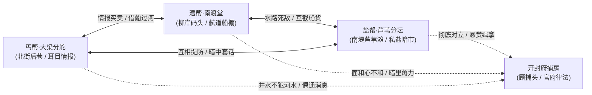

# 门派师承、机缘拜师与退门体系完整设计

本文档是《听风录》正式门派（师承）系统的完整策划与制作基准，可直接用于编写 YAML 内容脚本与 Geisha 服务端原语。

核心原则与 [主线剧情大纲](./story-outline.md) 一致：**门派不是挂在山门前的“招生办”，而是玩家在过自己的江湖日子时，因性情、处事分寸、出身或某次不经意的善恶选择，机缘巧合撞上的师徒缘分。**

---

## 一、正式师门 vs 江湖散学

| 层级 | 代表内容 | 排他性 | 说明 |
| --- | --- | --- | --- |
| **江湖散学 / 人情传艺** | 南门武馆（梁教头）、捕房锁拿手、漕帮踏浪步、黄河南渡杨家枪、白马寺明心齐眉棍、洛阳残谱室、大理外院护身拳/苍山裂石掌、太湖常客传艺、私学《威远剑法》 | **不排他** | 凭交情、名帖或旧物习得，不占正式师门名额，供前期自由摸索兵器与套路。 |
| **正式师门** | **四方名门**：少林外门、武当清修、五岳·嵩阳一脉、太湖水榭真传<br>**开封三堂口**：丐帮（开封大梁分舵）、漕帮（汴河南渡堂）、盐帮（黄河芦苇分坛） | **同时最多 1 个在籍** | 须经特定机缘触发并行拜师/入堂礼；解锁更高阶门派/堂口武学（上限 45–48 级）、专属信物与江湖回响，同时背负门规与退门代价。 |

---

## 二、少林双轨制：俗家入门，可选出家

1. **第一层：少林俗家外门弟子（默认，不出家）**
   - **男女皆可**，不剃度、不改法号、照常出入茶楼酒肆与市井营生。
   - 通过洛阳白马寺“借伞扫碑”机缘拜入，定位为明清武侠中的少林俗家外门弟子。
   - 体面离门走常规 **「出师」** 流程。
2. **第二层：落发受戒·正式出家（预留给少室山阶段的可选进阶）**
   - 仅限**男性角色**、已入少林俗家且无破戒/叛师记录者，可在少室山方丈室主动申请**落发剃度**（写入 `sect.shaolin.ordained`）。
   - 得赐法号（如“澄字辈”），解锁达摩院/藏经阁高阶禅功，受完整僧戒约束（忌杀生、忌接黑活，出入瓦子酒肆有特殊对白）。
   - 离门改为 **「还俗」**：须当面禀明方丈归还戒牒与僧衣，体面离寺（保留武功、允许再入他门）；若私自破戒逃寺，按 **「逐出山门（叛师）」** 论处。

---

## 三、七大正式师门角色清单（NPC 设计）

### 1. 少林外门（洛阳东郊·白马寺）

| NPC ID | 姓名 | 位置（地图 / 坐标） | 身份与性格口癖 | 教授武学与上限 | 战斗档位 |
| --- | --- | --- | --- | --- | --- |
| `baima_stone_sweeper` *(复用现有)* | **扫碑老人（法号：澄尘）** | `luoyang_city [-1, 7]` 白马寺古碑亭 | 少林罗汉堂退隐宿老，在白马寺扫了四十年落叶。说话慢条斯理，爱借石碑与竹帚点人，讨厌油滑卖弄。 | `luohan_subduing_staff: 30`、`shaolin_vajra_body: 30`、`basic_staff: 28`、`basic_internal: 26`（`teach_requires: sect.active.shaolin`） | 非主动战，仅考验战中以木棍喂招 |
| `shaolin_trial_monk` *(新增，hidden)* | **罗汉堂执事僧·慧石** | `luoyang_city [0, 7]` 白马寺外山门 | 奉少室山之命来白马寺取经卷的武僧，身材敦实，出棍如铁柱落地。 | 无 | `luohan_subduing_staff` 20级、`shaolin_vajra_body` 18级，HP 260，Qi 180（出师试对手） |
| `shaolin_enforcer_monk` *(新增，hidden)* | **少林戒律院师兄** | `luoyang_city [0, 6]` 白马寺官道 | 叛师后偶遇的问责武僧，不废话、不下死手，只求收回一分火候。 | 无 | `luohan_subduing_staff` 18级，HP 230 |

### 2. 武当清修（开封府·武庙前街 & 瓦子茶楼）

| NPC ID | 姓名 | 位置（地图 / 坐标） | 身份与性格口癖 | 教授武学与上限 | 战斗档位 |
| --- | --- | --- | --- | --- | --- |
| `wudang_wandering_taoist` *(新增)* | **清虚道长** | `kaifeng_city [-1, 2]` 武庙前街 | 穿洗白青道袍、腰挂旧葫芦的武当采药执事师叔。看着像个爱打盹的邋遢老道，其实步法极稳，口癖“莫急，气先沉下去”。 | `wudang_taiji_sword: 30`、`chunyang_breath: 30`、`basic_sword: 26`、`basic_internal: 28`（`teach_requires: sect.active.wudang`） | 出师试亲自拆招：`wudang_taiji_sword` 22级、`chunyang_breath` 20级，HP 255，Qi 220 |
| `shrine_street_ruffian` *(新增，hidden)* | **武庙泼皮头子** | `kaifeng_city [-1, 2]` 武庙前街 | 借收香火钱名义欺负外地游方客的地痞。 | 无 | `nameless_trial_fist` 6级，HP 95（机缘触发战） |
| `wudang_enforcer_disciple` *(新增，hidden)* | **武当巡山道人** | `north_post_road [0, 1]` 低松驿路 | 叛师后在北郊松林拦路问责的同门师兄，言辞清冷。 | 无 | `wudang_taiji_sword` 18级，HP 220 |

### 3. 五岳·嵩阳一脉（洛阳·洛水冷泉 & 牡丹会场）

| NPC ID | 姓名 | 位置（地图 / 坐标） | 身份与性格口癖 | 教授武学与上限 | 战斗档位 |
| --- | --- | --- | --- | --- | --- |
| `songyang_elder` *(新增)* | **嵩阳剑痴·陆寒松** | `luoyang_city [1, 5]` 洛水冷泉 | 嵩阳客宋秋河的师叔，常年独行中原访剑。性格孤傲直率，看剑不看出身，口癖“剑慢了半寸，说再多都是虚的”。 | `songyang_cloud_sword: 30`、`yuezhi_footwork: 30`、`basic_sword: 30`、`basic_lightness: 28`（`teach_requires: sect.active.songyang`） | 入派十招试炼对手（压低战力）：`songyang_cloud_sword` 15级，HP 195 |
| `songyang_rival_lin` *(新增，hidden)* | **华山游剑客·林昭** | `luoyang_city [0, 4]` 牡丹会场 | 听闻嵩阳门下出了新秀，专程登台试剑的五岳同辈。 | 无 | `songyang_cloud_sword` 21级、`yuezhi_footwork` 18级，HP 250，Qi 190（出师试对手） |
| `songyang_enforcer_disciple` *(新增，hidden)* | **嵩阳执剑师兄** | `luoyang_city [0, 2]` 南市口 | 叛师后登门讨剑的同门，脾气最烈。 | 无 | `songyang_cloud_sword` 19级，HP 230 |

### 4. 太湖水榭真传（太湖水榭）

| NPC ID | 姓名 | 位置（地图 / 坐标） | 身份与性格口癖 | 教授武学与上限 | 战斗档位 |
| --- | --- | --- | --- | --- | --- |
| `taihu_senior` *(复用现有)* | **太湖白发医者** | `taihu_water_pavilion [0, 4]` 水榭药堂 | 水榭主人，慈眉却极有原则。收为真传后亲自传授水榭镇榭绝学。 | 新增：`taihu_tide_sword: 30`、`bibo_mending_art: 32`（`teach_requires: sect.active.taihu`） | 非主动战 |
| `taihu_poisoned_guest` *(新增，hidden)* | **垂危江湖客** | `taihu_water_pavilion [-1, 3]` 切脉房 | 中了碧水毒砂重毒的北来商客，是触发真传机缘的关键病人。 | 无 | 非战斗 NPC |
| `taihu_plague_raider` *(新增，hidden)* | **投毒暗桩头目** | `taihu_water_pavilion [-1, 5]` 芦苇暗港 | 试图往湖岸水源下毒逼迫水榭就范的盐帮死士（出师试对手）。 | 无 | `salt_gang_poison_fist` 20级，HP 245，Qi 180 |

### 5. 丐帮 · 开封大梁分舵（开封府·北街后巷）

| NPC ID | 姓名 | 位置（地图 / 坐标） | 身份与性格口癖 | 教授武学与上限 | 战斗档位 |
| --- | --- | --- | --- | --- | --- |
| `alley_old_beggar` *(新增)* | **九爷（丐帮七袋长老·韩九）** | `kaifeng_city [-1, 3]` 北街后巷 | 丐帮开封大梁分舵执事长老，破衣陈七口中的“九爷”。平时装疯卖傻靠墙晒太阳，其实执掌中原水陆耳目。最烦名门正派端架子，口癖“规矩是给活人用的，不是拴狗的”。 | `chansi_dog_staff: 30`、`xiaoyao_beggar_step: 30`、`basic_staff: 28`、`basic_lightness: 30`（`teach_requires: sect.active.beggar`） | 非主动战 |
| `alley_salt_enforcer` *(新增，hidden)* | **盐帮恶棍** | `kaifeng_city [-1, 3]` 北街后巷 | 找老叫花撒气的盐帮小头目（机缘触发战）。 | 无 | `salt_gang_poison_fist` 9级，HP 135 |
| `alley_vengeance_boss` *(新增，hidden)* | **盐帮铁尺堂主** | `kaifeng_city [1, -2]` 船棚 | 寻仇杀到开封码头的盐帮硬茬（出师试对手）。 | 无 | `kaifeng_saber` 20级、`salt_gang_poison_fist` 18级，HP 265，Qi 190 |

### 6. 漕帮 · 汴河南渡堂（开封府·柳岸码头 & 船棚）

| NPC ID | 姓名 | 位置（地图 / 坐标） | 身份与性格口癖 | 教授武学与上限 | 战斗档位 |
| --- | --- | --- | --- | --- | --- |
| `caoban_du_san` *(复用现有)* | **过江鳅·杜三** | `kaifeng_city [-1, -3]` 柳岸码头 | 汴河南渡堂把头，重水路义气与码头发财，最恨官府卡税和盐帮抢桩。入堂后正式传授南渡堂压箱刀法与步法。 | 新增：`caoban_river_saber: 30`、`caoban_tide_step: 30`、`basic_blade: 28`（`teach_requires: sect.active.caoban`） | 非主动战 |
| `caoban_dock_mate` *(新增)* | **船棚大副·水牛张** | `kaifeng_city [1, -2]` 船棚 | 杜三的副手，光膀扛缆绳的豪爽汉子，负责发漕帮日常差事与同门切磋喂招。 | 无（常驻切磋对手） | `caoban_river_saber` 14级，HP 190，支持 `sparring` |
| `caoban_grad_raider` *(新增，hidden)* | **盐帮过江蛟** | `north_post_road [-1, 5]` 南堤芦苇滩 | 趁夜率船冲击南渡航道的盐帮水战头目（漕帮出师试对手）。 | 无 | `salt_shadow_blade` 21级、`salt_venom_palm` 18级，HP 265，Qi 190 |

### 7. 盐帮 · 黄河芦苇分坛（北郊递道·南堤芦苇滩 & 旧烽火台墩）

| NPC ID | 姓名 | 位置（地图 / 坐标） | 身份与性格口癖 | 教授武学与上限 | 战斗档位 |
| --- | --- | --- | --- | --- | --- |
| `salt_gang_deputy` *(复用现有)* | **盐帮香主·罗七** | `north_post_road [-1, 5]` 南堤芦苇滩 | 盐帮黄河分坛香主，精明狠辣却极护短。只要你肯干私盐脏活、不向官府递话，赏银与毒功都给得最痛快。 | 新增：`salt_venom_palm: 30`、`salt_shadow_blade: 30`、`basic_blade: 28`（`teach_requires: sect.active.saltgang`） | 非主动战（入坛后转为师父态） |
| `salt_scout_liu` *(新增)* | **暗滩哨子·泥鳅刘** | `north_post_road [1, 5]` 旧烽火台墩 | 帮盐帮瞭望官差与漕帮船只的放风头目，负责发盐帮日常差事、卖暗市毒药并同门切磋。 | 无（常驻切磋 + 黑市小铺） | `salt_venom_palm` 14级，HP 180，支持 `sparring` |
| `salt_grad_constable` *(新增，hidden)* | **府衙铁面巡检** | `north_post_road [0, 5]` 黄河南堤 | 奉顾捕头之命带队封锁南堤截查私盐的官府高手（盐帮出师试对手）。 | 无 | `yamen_grappling_hand` 22级、`bianliang_spear` 20级，HP 270，Qi 190 |

---

## 四、十四门正式师门武学规格（Martial Arts）

所有招式均直接绑定当前客户端已通过校验的 `combat_actions/` 动作 ID（零新动画阻塞），上限统一拉到 **40–45 级**（高于入门 25 级、略高于/平齐现有地域 40–45 级，但在主动技能机制上形成鲜明的门派流派分化）。

### 1. 少林外门：重守、破防、持久刚猛

#### ① `luohan_subduing_staff`《罗汉伏魔棍》（`type: staff`, `tier: regional`, `foundation: basic_staff`, `max_level: 45`）
- **前置**：`basic_staff >= 12`, `basic_internal >= 10`
- **普攻招式**：
  1. `luohan_sweep_dust`「扫叶归根」（1 级，伤害 16，`rig.staff.sweep_a`）
  2. `luohan_lift_bell`「托钟镇岳」（10 级，伤害 20，`rig.sword.rising_cut_a`）
  3. `luohan_heavy_staff`「金刚杵地」（20 级，伤害 25，`rig.staff.smash_a`）
- **主动绝招**：
  1. `luohan_iron_wall`「罗汉封门」（4 级，Self，Qi 40，AP 45，CD 14s，`rig.sword.guard`）：自身获 `iron_body_buff`（14s, val 5）+ `focused_guard`（14s, val 2）。
  2. `luohan_subdue_demon`「伏魔重击」（14 级，Single，Qi 65，AP 80，CD 16s，`rig.staff.smash_a`）：伤害 98，附加目标 `weakened`（10s, val 2）。

#### ② `shaolin_vajra_body`《少林金刚护体》（`type: internal`, `tier: regional`, `foundation: basic_internal`, `max_level: 45`）
- **前置**：`basic_internal >= 14`
- **主动绝招**：
  1. `vajra_golden_bell`「金刚罩体」（3 级，Self，Qi 50，AP 45，CD 16s，`rig.fist.guard`）：自身获 `iron_body_buff`（16s, val 6）。
  2. `vajra_zen_recovery`「禅定回春」（16 级，Self，Qi 75，AP 60，CD 20s，`rig.fist.healing_palm`）：疗伤 95，`cleanse: [debuff]`，附加 `iron_body_buff`（10s, val 4）。

---

### 2. 武当清修：以守带攻、招架反制、绵长回气

#### ③ `wudang_taiji_sword`《武当太极剑》（`type: sword`, `tier: regional`, `foundation: basic_sword`, `max_level: 45`）
- **前置**：`basic_sword >= 12`, `basic_internal >= 12`
- **普攻招式**：
  1. `taiji_draw_circle`「揽雀画圆」（1 级，伤害 15，`rig.sword.cut_a`）
  2. `taiji_point_star`「指南定针」（10 级，伤害 19，`rig.sword.thrust_a`）
  3. `taiji_cloud_lift`「云手挑剑」（20 级，伤害 23，`rig.sword.rising_cut_a`）
- **主动绝招**：
  1. `taiji_circle_guard`「画圆卸力」（3 级，Self，Qi 38，AP 45，CD 13s，`rig.sword.guard`）：自身获 `focused_guard`（15s, val 3）+ `iron_body_buff`（12s, val 3）。
  2. `taiji_borrow_force`「借力回剑」（12 级，Single，**需前置 `focused_guard`**，Qi 62，AP 75，CD 15s，`rig.sword.sword_net_a`）：伤害 112，附加目标 `weakened`（10s, val 2）。

#### ④ `chunyang_breath`《纯阳吐纳功》（`type: internal`, `tier: regional`, `foundation: basic_internal`, `max_level: 45`）
- **前置**：`basic_internal >= 14`
- **主动绝招**：
  1. `chunyang_clear_qi`「纯阳化浊」（4 级，Self，Qi 45，AP 45，CD 14s，`rig.fist.healing_palm`）：疗伤 55，`cleanse: [debuff, dot]`。
  2. `chunyang_steady_meridian`「抱元守一」（15 级，Self，Qi 65，AP 55，CD 18s，`rig.fist.guard`）：疗伤 80，自身获 `focused_guard`（16s, val 2）+ `iron_body_buff`（16s, val 4）。

---

### 3. 五岳·嵩阳一脉：极致快剑、破防流血、先手压制

#### ⑤ `songyang_cloud_sword`《嵩阳叠云剑》（`type: sword`, `tier: regional`, `foundation: basic_sword`, `max_level: 45`）
- **前置**：`basic_sword >= 14`, `basic_lightness >= 10`
- **普攻招式**：
  1. `songyang_split_cloud`「拨云见锋」（1 级，伤害 17，`rig.sword.chop_a`）
  2. `songyang_pierce_mist`「穿云疾刺」（10 级，伤害 21，`rig.sword.thrust_a`）
  3. `songyang_falling_peak`「叠峰压顶」（20 级，伤害 26，`rig.sword.cut_a`）
- **主动绝招**：
  1. `songyang_bleed_thrust`「断崖穿心」（4 级，Single，Qi 50，AP 65，CD 12s，`rig.sword.thrust_a`）：伤害 72，附加目标 `bleeding`（10s, val 6）。
  2. `songyang_cloud_net`「五岳叠云」（15 级，Single，Qi 82，AP 90，CD 18s，`rig.sword.sword_net_a`）：伤害 135，附加目标 `bleeding`（8s, val 8）。

#### ⑥ `yuezhi_footwork`《岳峙步》（`type: lightness`, `tier: regional`, `foundation: basic_lightness`, `max_level: 45`）
- **前置**：`basic_lightness >= 12`
- **主动绝招**：
  1. `yuezhi_side_step`「绝壁挪步」（4 级，Self，Qi 35，AP 40，CD 12s，`rig.fist.guard`）：自身获 `focused_guard`（12s, val 2）。
  2. `yuezhi_flying_kick`「凌崖惊踢」（14 级，Single，Qi 60，AP 70，CD 15s，`rig.fist.leap_kick_a`）：伤害 84。

---

### 4. 太湖水榭真传：最强续航、解毒克制、柔韧消耗

#### ⑦ `taihu_tide_sword`《水榭听涛剑》（`type: sword`, `tier: regional`, `foundation: basic_sword`, `max_level: 45`）
- **前置**：`basic_sword >= 12`, `basic_internal >= 12`
- **普攻招式**：
  1. `tide_skim_lotus`「荷影点波」（1 级，伤害 15，`rig.sword.cut_a`）
  2. `tide_part_reeds`「分苇寒光」（10 级，伤害 19，`rig.sword.rising_cut_a`）
  3. `tide_return_wave`「回澜截脉」（20 级，伤害 23，`rig.sword.thrust_a`）
- **主动绝招**：
  1. `tide_listening_wave`「听涛卸锋」（4 级，Single，Qi 48，AP 65，CD 13s，`rig.sword.qi_wave_a`）：伤害 66，附加目标 `weakened`（12s, val 2）。
  2. `tide_mist_net`「烟波剑网」（15 级，Single，Qi 72，AP 80，CD 17s，`rig.sword.sword_net_a`）：伤害 102，自身获 `focused_guard`（12s, val 2），目标获 `weakened`（8s, val 2）。

#### ⑧ `bibo_mending_art`《碧波续脉诀》（`type: internal`, `tier: regional`, `foundation: basic_internal`, `max_level: 48`）
- **前置**：`basic_internal >= 14`
- **主动绝招**：
  1. `bibo_detox_breath`「碧波涤毒」（3 级，Self，Qi 42，AP 40，CD 12s，`rig.fist.healing_palm`）：疗伤 68，`cleanse: [dot, debuff]`。
  2. `bibo_mending_tide`「续脉回澜」（16 级，Self，Qi 80，AP 55，CD 18s，`rig.fist.healing_palm`）：疗伤 125，`cleanse: [dot, debuff]`，自身获 `iron_body_buff`（12s, val 3）。

---

### 5. 丐帮（开封大梁分舵）：高机动、刁钻破招、不拘正邪

#### ⑨ `chansi_dog_staff`《丐帮缠丝棒》（`type: staff`, `tier: regional`, `foundation: basic_staff`, `max_level: 45`）
- **前置**：`basic_staff >= 12`, `basic_lightness >= 12`
- **普攻招式**：
  1. `dog_poke_ankle`「拨狗朝天」（1 级，伤害 15，`rig.sword.rising_cut_a`）
  2. `dog_sweep_lane`「横扫暗巷」（10 级，伤害 20，`rig.staff.sweep_a`）
  3. `dog_seal_gate`「恶犬拦路」（20 级，伤害 24，`rig.staff.smash_a`）
- **主动绝招**：
  1. `dog_tangle_trip`「缠字绊步」（4 级，Single，Qi 44，AP 60，CD 12s，`rig.staff.sweep_a`）：伤害 64，附加目标 `weakened`（12s, val 2）。
  2. `dog_no_way_out`「棒打双犬」（16 级，Single，Qi 78，AP 85，CD 17s，`rig.staff.smash_a`）：伤害 126，附加目标 `bleeding`（8s, val 6）+ `weakened`（8s, val 2）。

#### ⑩ `xiaoyao_beggar_step`《逍遥游步》（`type: lightness`, `tier: regional`, `foundation: basic_lightness`, `max_level: 45`）
- **前置**：`basic_lightness >= 12`
- **主动绝招**：
  1. `alley_slip_away`「钻巷泥鳅」（3 级，Self，Qi 32，AP 40，CD 11s，`rig.fist.guard`）：自身获 `focused_guard`（14s, val 3）。
  2. `alley_sneak_kick`「穿花拂柳腿」（14 级，Single，Qi 56，AP 65，CD 14s，`rig.fist.kick_a`）：伤害 82，附加目标 `weakened`（8s, val 1）。

### 6. 漕帮（汴河南渡堂）：重刀压阵、船头稳身、水路硬拼

#### ⑪ `caoban_river_saber`《汴河断浪刀》（`type: blade`, `tier: regional`, `foundation: basic_blade`, `max_level: 45`）
- **前置**：`basic_blade >= 12`, `basic_lightness >= 10`
- **普攻招式**：
  1. `river_split_wave`「顺水劈浪」（1 级，伤害 16，`rig.sword.cut_a`）
  2. `river_sweep_deck`「横扫船头」（10 级，伤害 21，`rig.blade.sweep_a`）
  3. `river_anchor_chop`「沉锚重斩」（20 级，伤害 26，`rig.blade.cleave_a`）
- **主动绝招**：
  1. `river_iron_cable`「铁索横江」（4 级，Single，Qi 48，AP 65，CD 13s，`rig.blade.sweep_a`）：伤害 72，附加目标 `weakened`（10s, val 2）。
  2. `river_break_tide`「断浪开闸」（15 级，Single，Qi 78，AP 85，CD 17s，`rig.blade.cleave_a`）：伤害 130，附加目标 `bleeding`（8s, val 6）。

#### ⑫ `caoban_tide_step`《过江踏浪步》（`type: lightness`, `tier: regional`, `foundation: basic_lightness`, `max_level: 45`）
- **前置**：`basic_lightness >= 12`
- **主动绝招**：
  1. `tide_steady_plank`「稳板踏波」（3 级，Self，Qi 34，AP 40，CD 12s，`rig.fist.guard`）：自身获 `focused_guard`（14s, val 3）+ `iron_body_buff`（10s, val 2）。
  2. `tide_oar_kick`「过江翻浪踢」（14 级，Single，Qi 58，AP 70，CD 15s，`rig.fist.leap_kick_a`）：伤害 86。

### 7. 盐帮（黄河芦苇分坛）：青毒叠加、狠辣快刀、高收益黑道

#### ⑬ `salt_venom_palm`《五毒蚀骨掌》（`type: fist`, `tier: regional`, `foundation: basic_fist`, `max_level: 45`）
- **前置**：`basic_fist >= 12`, `basic_internal >= 10`
- **普攻招式**：
  1. `venom_sand_slap`「暗沙拍脉」（1 级，伤害 15，`rig.fist.punch_a`）
  2. `venom_cold_palm`「阴风蚀骨」（10 级，伤害 20，`rig.fist.palm_knockback_a`）
  3. `venom_combo_claw`「毒龙连爪」（20 级，伤害 24，`rig.fist.combo_a`）
- **主动绝招**：
  1. `venom_green_mist`「碧雾散毒」（4 级，Single，Qi 46，AP 60，CD 12s，`rig.fist.palm_knockback_a`）：伤害 58，附加目标 `poisoned`（12s, val 7）。
  2. `venom_bone_rotting`「五毒摧心」（16 级，Single，Qi 80，AP 85，CD 17s，`rig.fist.combo_a`）：伤害 108，附加目标 `poisoned`（12s, val 9）+ `weakened`（10s, val 2）。

#### ⑭ `salt_shadow_blade`《夜渡鬼头刀》（`type: blade`, `tier: regional`, `foundation: basic_blade`, `max_level: 45`）
- **前置**：`basic_blade >= 12`, `basic_lightness >= 12`
- **普攻招式**：
  1. `shadow_quick_slash`「暗滩斜削」（1 级，伤害 16，`rig.sword.cut_a`）
  2. `shadow_low_sweep`「苇丛撩刀」（10 级，伤害 21，`rig.blade.sweep_a`）
  3. `shadow_heavy_hack`「鬼头断魂」（20 级，伤害 26，`rig.blade.cleave_a`）
- **主动绝招**：
  1. `shadow_poison_edge`「淬毒抹颈」（4 级，Single，Qi 50，AP 65，CD 13s，`rig.blade.sweep_a`）：伤害 68，附加目标 `poisoned`（10s, val 6）+ `bleeding`（8s, val 5）。
  2. `shadow_night_raid`「夜袭断渡」（16 级，Single，Qi 82，AP 90，CD 18s，`rig.blade.cleave_a`）：伤害 136。

---

## 五、完整任务线设计（入派 / 出师 / 叛师 / 洗心）

### A. 机缘入派任务线（7 条）

| 任务 ID | 名称 | 触发前置 | 阶段流转（Stages） | 核心考验与奖励 |
| --- | --- | --- | --- | --- |
| `sect_join_shaolin` | **碑阴借伞** | `luoyang.wensheng_trusted`、`basic_internal >= 10`（或 `basic_staff >= 10`）、`!sect.has_active`、`!sect.betrayed.any` | `umbrella_meet`（雨天重访古碑亭，扫碑老人递棍考校） → `stele_stance`（去山门茶寮与明心印证或回亭接老人三招木棍喂招） → `completed`（老人亮明罗汉堂身份，收为少林俗家外门） | 奖励：`shaolin_wooden_beads`（旧木念珠信物）、习得《罗汉伏魔棍》1 级、《少林金刚护体》1 级，`set_flag: sect.active.shaolin` + `sect.has_active`，实战经验 +60 / 潜能 +45。 |
| `sect_join_wudang` | **武庙扶道** | `first_steps_kaifeng` 完成、`basic_internal >= 12`（`creation.childhood2.breath_lessons` 降为 8 级）、`!sect.has_active`、`!sect.betrayed.any` | `ruffian_trouble`（进武庙前街见泼皮欺负清虚道长） → `bowl_verse`（击退泼皮后道长留碗底口诀，去任意洞天/客舍静思，如南门演武场或樊楼） → `return_taoist`（回武庙前街印证口诀） → `completed`（拜入武当外门） | 奖励：`wudang_jade_talisman`（青竹道牌）、习得《武当太极剑》1 级、《纯阳吐纳功》1 级，`set_flag: sect.active.wudang` + `sect.has_active`，实战经验 +60 / 潜能 +45。 |
| `sect_join_songyang` | **冷泉试剑** | `luoyang.peony_duel_won`、`basic_sword >= 14`、`!sect.has_active`、`!sect.betrayed.any` | `pool_encounter`（进洛水冷泉遇陆寒松磨剑） → `ten_moves_trial`（与陆寒松点到为止试剑一战） → `completed`（陆寒松破格收为嵩阳外山弟子） | 奖励：`songyang_sword_tassel`（青丝剑穗）、习得《嵩阳叠云剑》1 级、《岳峙步》1 级，`set_flag: sect.active.songyang` + `sect.has_active`，实战经验 +65 / 潜能 +50。 |
| `sect_join_taihu` | **碧波救危** | `taihu.inner_guest` + 医缘 flag 之一（`creation.origin.medicine_house` / `creation.childhood1.herb_gathering` / `explore.taihu_decoction_room`）、`!sect.has_active`、`!sect.betrayed.any` | `check_patient`（水榭药堂白发医者急唤去切脉房看垂危江湖客） → `mix_antidote`（玩家认出碧水毒砂，去方书阁找沈青笺取解药并到煎药房熬制） → `report_master`（救回病人回药堂，白发医者行收徒礼） → `completed` | 奖励：`taihu_jade_needle`（水榭玉针）、习得《水榭听涛剑》1 级、《碧波续脉诀》1 级，`set_flag: sect.active.taihu` + `sect.has_active`，实战经验 +65 / 潜能 +50。 |
| `sect_join_beggar` | **暗巷分药** | 满足任一市井缘（`creation.origin.orphan` / `creation.childhood2.market_brawls` / `jianghu.canal_handed_caoban` / `sect.betrayed.any`）、`!sect.has_active` | `alley_bully`（进北街后巷见盐帮恶棍欺负九爷，分金创药或出手相助） → `defeat_enforcer`（击退盐帮恶棍，九爷露一手绝妙棒法） → `completed`（拜入丐帮开封大梁分舵，受封一袋弟子） | 奖励：`beggar_bamboo_token`（大梁分舵青竹牌）、习得《丐帮缠丝棒》1 级、《逍遥游步》1 级，`set_flag: sect.active.beggar` + `sect.has_active`，实战经验 +60 / 潜能 +45。 |
| `sect_join_caoban` | **南渡拜旗** | `jianghu.caoban_friend`（《码头规矩》获“南渡客”）+《汴河夜航》把铁匣交给了杜三（`jianghu.canal_handed_caoban`）、`!sect.has_active` | `dock_toast`（回柳岸码头见杜三邀你喝“上船酒”） → `boat_shed_trial`（赴船棚替大副水牛张撑住一轮夜渡查船，击退摸黑抢缆的盐帮水鬼） → `completed`（杜三正式收你入汴河南渡堂为「押船舵手」） | 奖励：`caoban_iron_tally`（南渡堂铁牌）、习得《汴河断浪刀》1 级、《过江踏浪步》1 级，`set_flag: sect.active.caoban` + `sect.has_active`，实战经验 +60 / 潜能 +45。 |
| `sect_join_saltgang` | **暗滩投名** | 未把铁匣交官府（`!jianghu.canal_reported_yamen`）或曾背负叛师印记（`sect.betrayed.any`），且去过北郊旧烽火台墩/南堤芦苇滩、`!sect.has_active` | `beacon_signal`（在旧烽火台墩撞见泥鳅刘替重伤的罗七讨药） → `deliver_salt_med`（带 1 包金创药赴南堤芦苇滩救治罗七，并替他挡下追查至此的捕房探子） → `completed`（罗七赏识你的胆色，收你入黄河芦苇分坛为「暗滩脚夫」） | 奖励：`salt_black_seal`（暗盐黑印）、习得《五毒蚀骨掌》1 级、《夜渡鬼头刀》1 级，`set_flag: sect.active.saltgang` + `sect.has_active`，银钱 +60 / 实战经验 +60 / 潜能 +45；同时顾捕头拉黑拒教。 |

> **若已有在籍师门（`sect.has_active`）**：以上 5 位师父仍可对话，会触发专属“惜才但各为其主”对白（例如陆寒松会说：“可惜你身上已经带着别家师门的印子，剑路虽好，老夫不夺人弟子”）。

---

### B. 门派内部阶梯与「升级拜师」（外门记名 → 入室亲传 / 高辈引荐）

正式门派不是“拜完一次师就闷头挂机到出师”，而是走 **三阶师门成长**：

```text
一阶：外门/记名弟子（机缘入派）
  └─ 学第 1 门招牌武学（受教上限 18 级）+ 开放本门日常差事 + 同门切磋
      ↓（武学 ≥ 14 级 + 完成本门中阶内部任务线）
二阶：入室亲传 / 升级拜师（升阶仪式或高辈师父引荐）
  └─ 写入 sect.rank.inner.<id>，解锁第 2 门镇派内功/轻功、受教上限拉升至 30–32 级、开放门内补给/专属交互
      ↓（核心武学 ≥ 26 级 + 完成出师试）
三阶：体面出师（自立门户，保留全部武学，允许后续另拜高师）
```

#### 五大门派「升级拜师」与门内中阶剧情任务线

| 门派 | 升级拜师路径（一阶 → 二阶） | 门内中阶任务 ID 与名称 | 触发条件 | 任务流程与核心体验 | 晋升回报 |
| --- | --- | --- | --- | --- | --- |
| **少林外门** | 白马寺 `知客僧明心` / `扫碑老人` 记名俗家 → 由 `扫碑老人（澄尘）` 亲授罗汉堂内门法脉（远期少室山可再拜达摩院/可选出家） | `sect_inner_shaolin` **经卷蒙尘** | `sect.active.shaolin` + `luohan_subduing_staff >= 14` | 白马寺经阁遗失一卷罗汉堂护体注疏。先向 `知客僧明心` 查问香客名录 → 赴洛水旧堰亭查访偷卷的落魄剑客 → 切磋制住但不伤其性命，劝其归还残卷并带回古碑亭。 | 写入 `sect.rank.inner.shaolin`；澄尘正式行入室授珠礼，开放《少林金刚护体》传授并将《罗汉伏魔棍》受教上限从 18 提至 30 级。 |
| **武当清修** | 武庙 `清虚道长` 记名清修 → 授武当紫霄外传道箓，入室亲传太极剑意 | `sect_inner_wudang` **假道惑众** | `sect.active.wudang` + `chunyang_breath >= 14` | 西市街口与瓦子茶楼出现假冒武当道人兜售“延寿金丹”骗钱。向 `张一嘴` 打听假道行踪 → 在西市老井/北街后巷当面拆穿其丹方错漏并击退其雇来的护卫 → 追回假丹交还清虚。 | 写入 `sect.rank.inner.wudang`；清虚正式授以武当外传道箓，解锁《武当太极剑》高阶传授至 30 级，并赠 2 包 `clear_spirit_san`。 |
| **五岳·嵩阳** | `嵩阳客宋秋河` 引荐 / `陆寒松` 外山记名 → 正式拜入 `陆寒松` 门下为入室剑徒 | `sect_inner_songyang` **旧剑归鞘** | `sect.active.songyang` + `songyang_cloud_sword >= 14` | 洛阳旧剑市流出一柄刻有嵩阳旧徽的断剑。找 `冯三寸` 问清来历 → 前往天津桥头会见借旧剑四处挑衅嵩阳名声的游侠 → 堂堂正正以快剑胜之，请回旧剑呈交陆寒松。 | 写入 `sect.rank.inner.songyang`；陆寒松正式收为入室剑徒，解锁《岳峙步》真传并将《嵩阳叠云剑》受教上限提至 30 级。 |
| **太湖真传** | 水榭记名药徒 → 由 `白发医者` 与 `沈青笺` 共同授以水榭「执方弟子」真传 | `sect_inner_taihu` **暗港溯毒** | `sect.active.taihu` + `taihu_tide_sword >= 14`（或 `bibo_mending_art >= 14`） | 顺着早前“碧水毒砂”查出太湖外围私售毒散的暗线。赴雾柳栈桥向 `陆执` 核对船货 → 赴芦苇暗港向 `翻江鲤` 借水路线索 → 截住私贩毒药的暗桩夺回毒囊，回方书阁助 `沈青笺` 记入病案。 | 写入 `sect.rank.inner.taihu`；白发医者授「水榭执方牌」，解锁《碧波续脉诀》传授至 32 级，药房补给赠 `taihu_mending_pill`。 |
| **丐帮·大梁分舵** | 开封大梁分舵一袋弟子（`破衣陈七` 领路） → 由七袋长老 `韩九` 升袋授青竹杖，晋升「三袋执杖弟子」 | `sect_inner_beggar` **大梁传信** | `sect.active.beggar` + `chansi_dog_staff >= 14` | 替韩九与 `破衣陈七` 串联开封分舵三处耳目点：依次走东巷铁铺、西市当铺、柳岸码头对暗语收信 → 在船棚识破并击退混进分舵摸底的盐帮眼线 → 回北街后巷复命升袋（可决定把截到的盐帮船期卖给漕帮杜三换钱，或交回分舵存档）。 | 写入 `sect.rank.inner.beggar`；韩九行升袋礼晋升三袋弟子，解锁《逍遥游步》真传并将《丐帮缠丝棒》受教上限提至 30 级。 |
| **漕帮·南渡堂** | 南渡堂押船舵手（`水牛张` 带路） → 由把头 `杜三` 授旗晋升「南渡执旗头目」 | `sect_inner_caoban` **汴河护漕** | `sect.active.caoban` + `caoban_river_saber >= 14` | 漕帮夜船遭盐帮盯上：先去北街后巷找丐帮 `破衣陈七` 买盐帮埋伏风声（丐帮×漕帮情报交易）→ 赴官仓核对封签 → 在船棚正面打退盐帮夜袭小队，回柳岸码头复命授旗。 | 写入 `sect.rank.inner.caoban`；杜三晋升你为执旗头目，解锁《过江踏浪步》真传并将《汴河断浪刀》受教上限提至 30 级。 |
| **盐帮·芦苇分坛** | 芦苇分坛暗滩脚夫（`泥鳅刘` 接引） → 由香主 `罗七` 授印晋升「私盐香头」 | `sect_inner_saltgang` **夜渡暗盐** | `sect.active.saltgang` + `salt_venom_palm >= 14`（或 `salt_shadow_blade >= 14`） | 盐帮要趁夜把一批精盐运进开封出手：先在旧烽火台墩向 `泥鳅刘` 探清捕房巡逻间隙 → 绕开丐帮后巷盯梢与漕帮暗哨，潜入西市当铺找 `秦朝奉` 秘密交割（并击退半路截货的漕帮暗哨）→ 回南堤芦苇滩分红升香头。 | 写入 `sect.rank.inner.saltgang`；罗七晋升你为私盐香头，解锁《夜渡鬼头刀》真传并将《五毒蚀骨掌》受教上限提至 30 级，赏 100 文。 |

---

### C. 门派专属可重复日常差事（`sect_job_*`）

入派后立刻开放，给门内弟子提供稳定的实战经验、潜能与银钱循环（同样走 `complete_job` 连续加成机制）：

| 差事 ID | 所属门派 | 接取 NPC | 玩法内容（跑腿 + 切磋/轻战斗） | 基础奖励 |
| --- | --- | --- | --- | --- |
| `sect_job_shaolin_scripture` | 少林外门 | `知客僧明心` | 清扫古碑亭落叶、到白马寺官道巡看香客并击退偶遇的劫路毛贼，回山门复命。 | 45 文 / 75 经验 / 55 潜能 |
| `sect_job_wudang_herbs` | 武当清修 | `清虚道长` | 赴北郊药草坡采药、在旧烽火台墩调息印证气机，回武庙前街复命。 | 42 文 / 70 经验 / 55 潜能 |
| `sect_job_songyang_duel` | 五岳·嵩阳 | `嵩阳客宋秋河` | 在牡丹会场与洛水步法廊巡剑，与来访游剑客切磋一局，回冷泉/会场复命。 | 50 文 / 85 经验 / 60 潜能 |
| `sect_job_taihu_clinic` | 太湖真传 | `守阁女医沈青笺` | 从煎药房取药，依次送至切脉房、雾柳栈桥与听雨荷亭巡诊，回方书阁复命。 | 45 文 / 72 经验 / 58 潜能 |
| `sect_job_beggar_rumor` | 丐帮·大梁分舵 | `破衣陈七` | 跑西市当铺、瓦子茶楼、柳岸码头替分舵收一圈江湖风声，在码头顺手赶跑探头探脑的盐帮眼线，回后巷复命。 | 48 文 / 80 经验 / 58 潜能 |
| `sect_job_caoban_escort` | 漕帮·南渡堂 | `船棚大副·水牛张` | 巡查汴水南渡、州桥船棚与官仓水口，击退摸黑割缆的盐帮水鬼，回船棚领分红。 | 52 文 / 82 经验 / 56 潜能 |
| `sect_job_saltgang_smuggle` | 盐帮·芦苇分坛 | `暗滩哨子·泥鳅刘` | 趁夜把暗盐样本从南堤芦苇滩送至西市当铺暗柜（绕开官差，途中击退拦路漕帮暗哨），回旧烽火台墩领重赏。 | 68 文 / 85 经验 / 55 潜能 |

---

### C-2. 开封三堂口三角交互网（丐帮 × 漕帮 × 盐帮 × 捕房）

丐帮、漕帮、盐帮同扎根在开封与北郊水陆线上，彼此不是孤立的三个菜单，而是构成一张实时联动的江湖关系网：



#### 具体跨堂口交互设计
1. **同一事件、三方视角（二阶晋升共享“汴河夜局”）**：
   - 丐帮《大梁传信》截获盐帮船期，可选择把消息卖给漕帮杜三或留归分舵；
   - 漕帮《汴河护漕》必须先去后巷向丐帮破衣陈七买情报，才能提前守住船棚挫败盐帮夜袭；
   - 盐帮《夜渡暗盐》则需要避开丐帮盯梢、打穿漕帮暗哨，把货送到西市当铺秦朝奉手里销赃。
2. **身份互斥与专属反应**：
   - **入盐帮**：开封府捕房顾捕头直接拉黑拒教、北郊捕房悬赏关闭；柳岸码头杜三见你立刻冷脸赶客；但西市当铺秦朝奉对盐帮弟子收货加价，泥鳅刘开放黑市毒药/金创药补给。
   - **入漕帮**：顾捕头冷眼敲打但仍允许你走官道；丐帮陈七乐意跟你做情报买卖；盐帮罗七彻底敌对。
   - **入丐帮**：三方里唯一能同时在码头、后巷、当铺、茶楼自由套话的“中间人”；即使曾经叛出名门正派，九爷也照收不误。
3. **跨堂口叛师 / 跳槽专属彩蛋**：
   - 从漕帮叛投盐帮：杜三怒骂“吃里扒外”，罗七大笑封赏额外 80 文并立刻接纳；
   - 从盐帮出师或叛出改投丐帮：九爷让你先交出毒砂袋立誓不再害百姓才肯收你进分舵；
   - 从丐帮出师后入漕帮：杜三极看重你在后巷攒下的耳目人脉，入堂对白直接夸“大梁分舵出来的人，眼尖腿快”。

---

### D. 门派 NPC 立体交互体系

让每个门派都有“活着的师门关系”，而不是只有一个冷冰冰的传功机器：

1. **师父（多层动态态变）**：
   - **一阶外门**：以考校根基、提醒门规为主；传授上限卡在 18 级，满 14 级主动抛出中阶门派任务线。
   - **二阶入室**：改口称“徒儿”，开放全部 30–32 级传授，并会**点评玩家身上的跨派武学**（例如澄尘/清虚见你练了《威远剑法》会提醒镖局招式偏急，见你沾了《碧水毒砂掌》会严厉敲打；九爷则反过来夸你“管他黑猫白猫，打赢就行”）。
   - **辞门/叛师入口**：对话中提供明确的“禀明出师”或“执意辞门（叛师）”分支（需二次确认防误触）。
2. **大师兄 / 同门陪练（常驻切磋 + 门内八卦）**：
   - 少林：`知客僧明心` / `罗汉堂执事僧`；武当：`武庙道童`（新增）；嵩阳：`嵩阳客宋秋河`（入派后可重复切磋喂剑）；太湖：`守亭剑客江晚舟`（对同门换温柔称呼）；丐帮大梁分舵：`破衣陈七`（可切磋身法 + 免费提供三城暗线提示）。
3. **门内补给与优待**：
   - 门内弟子在对应执事/药房处可享受专属照应（如武当/太湖二阶晋升及出师时赠高阶丹药，丐帮大梁分舵弟子可在陈七处低价买伤药或打听悬赏风声）。
4. **门派专属洞天共鸣**：
   - 本门弟子进入对应悟境房间（白马寺古碑亭、洛水冷泉、听雨荷亭、北郊旧烽火台墩等）时，触发 1 次专属门派感悟旁白，强化归属感。

---

### E. 体面出师任务线（5 条，统一二阶入室 + 26 级门槛）

| 任务 ID | 名称 | 触发条件 | 压轴考验 | 出师后果 |
| --- | --- | --- | --- | --- |
| `sect_grad_shaolin` | **出师·罗汉印证** | `sect.active.shaolin` + `sect.rank.inner.shaolin` + `luohan_subduing_staff >= 26` | 在白马寺外山门击败 `shaolin_trial_monk`（执事僧慧石） | 清除 `sect.active.shaolin` 与 `sect.has_active`，写入 `sect.graduated.shaolin`；保留全部武学，澄尘不再继续传授，赠 120 文 + 经验 120 / 潜能 90。 |
| `sect_grad_wudang` | **出师·太极拆招** | `sect.active.wudang` + `sect.rank.inner.wudang` + `wudang_taiji_sword >= 26` | 在武庙前街与 `wudang_wandering_taoist` 拆招胜出 | 同上结构，写入 `sect.graduated.wudang`。 |
| `sect_grad_songyang` | **出师·牡丹扬锋** | `sect.active.songyang` + `sect.rank.inner.songyang` + `songyang_cloud_sword >= 26` | 在牡丹会场击败登台试剑的 `songyang_rival_lin` | 同上结构，写入 `sect.graduated.songyang`。 |
| `sect_grad_taihu` | **出师·平毒护岸** | `sect.active.taihu` + `sect.rank.inner.taihu` + `taihu_tide_sword >= 26`（或 `bibo_mending_art >= 26`） | 在芦苇暗港击败企图投毒的 `taihu_plague_raider` | 同上结构，写入 `sect.graduated.taihu`。 |
| `sect_grad_beggar` | **出师·码头立威** | `sect.active.beggar` + `sect.rank.inner.beggar` + `chansi_dog_staff >= 26` | 在船棚击败寻仇的 `alley_vengeance_boss` | 同上结构，写入 `sect.graduated.beggar`。 |
| `sect_grad_caoban` | **出师·断浪平滩** | `sect.active.caoban` + `sect.rank.inner.caoban` + `caoban_river_saber >= 26` | 在南堤芦苇滩击败率船夜袭的 `caoban_grad_raider`（盐帮过江蛟） | 同上结构，写入 `sect.graduated.caoban`，获赠 140 文。 |
| `sect_grad_saltgang` | **出师·夜破封堤** | `sect.active.saltgang` + `sect.rank.inner.saltgang` + `salt_venom_palm >= 26`（或 `salt_shadow_blade >= 26`） | 在黄河南堤突破 `salt_grad_constable`（府衙铁面巡检）的封锁 | 同上结构，写入 `sect.graduated.saltgang`，获赠 160 文。 |

---

### F. 强行叛师、野外问责与大理「洗心赎罪」

1. **强行叛师（`sect_betrayal`）**：
   - 在籍弟子未达出师条件时，若在任意本门师父处对话触发“执意辞门/背弃师门”（可通过二次确认对话或专属辞门事件触发）：
     - 清除 `sect.active.<id>` 与 `sect.has_active`；
     - 写入 `sect.betrayed.<id>` 与 `sect.betrayed.any`；
     - 执行 `halve_art_level` 将本门 2 门独门武学层数折半（**基础功 100% 保留**）；
     - 原师父永久拒教（`forbid_flag: sect.betrayed.<id>`）。
2. **野外问责切磋（每门 1 次一次性事件）**：
   - 叛出少林/武当/嵩阳后，首次行经白马寺官道 / 北郊低松驿路 / 洛阳南市口时，会撞见原门派师兄拦路问责并强制进入一场点到即止的切磋战；无论胜负，恩怨暂了（写入 `sect.enforcer_met.<id>`，不无限骚扰）。
3. **大理崇圣寺「洗心赎罪」（`sect_redemption`）**：
   - **前置**：`sect.betrayed.any` 且已完成 `dali_chongsheng_bell`（《崇圣寺听钟》）。
   - **流程**：
     1. 找崇圣寺 `守塔僧枯木` 吐露叛师旧事，枯木不责骂，只嘱你以行动补过：去北郊或苍山完成 1 次清匪悬赏（或交付 1 粒 `taihu_mending_pill` 济助伤客），再回三塔院静听晚钟。
     2. 完成后枯木赠「洗心偈」（`clear_flag: sect.betrayed.any`、`set_flag: sect.redeemed`），正派门户重新对你开放机缘（但**原被叛的那个门派依然保留 `sect.betrayed.<id>`，不再复收**）。

---

### G. 茶楼说书人（`tea_storyteller` 张一嘴）回响表

| 触发 Flag | 说书人新评书要点 |
| --- | --- |
| `sect.active.shaolin` / `sect.graduated.shaolin` | 传闻白马寺扫碑的老僧原是少林罗汉堂宿老，竟收了个外乡俗家弟子。 |
| `sect.active.wudang` / `sect.graduated.wudang` | 听说武庙前街那个爱打盹的邋遢道士竟是武当师叔，有人替他解围得了真传。 |
| `sect.active.songyang` / `sect.graduated.songyang` | 洛阳冷泉边嵩阳剑痴破格收徒，江湖上怕又要多一把快剑。 |
| `sect.active.taihu` / `sect.graduated.taihu` | 太湖水榭向来只治病不收外徒，这回居然把一位救过毒伤客的少侠收入了真传。 |
| `sect.active.beggar` / `sect.graduated.beggar` | 北街后巷丐帮七袋长老韩九破天荒收了个徒弟，连盐帮的硬茬都讨不着好。 |
| `sect.active.caoban` / `sect.graduated.caoban` | 柳岸码头过江鳅杜三把南渡堂的铁牌交给了外乡新秀，汴河水路怕是又要变天。 |
| `sect.active.saltgang` / `sect.graduated.saltgang` | 压低嗓门说起黄河南堤芦苇荡里新出了个盐帮香头，出手带青毒，连捕房巡检都吃了暗亏。 |
| `sect.betrayed.any` | 压低声音聊起某位年轻好手未出师便掀了师门桌子，正派避之不及，暗巷里倒夸他有种。 |

---

## 六、Geisha 服务端最小扩展清单

当前引擎已具备 90% 能力，只需补 3 个极轻量的原语（不改存档结构）：

1. **`server/src/quest.gsa` + `gameplay.gsa`**：
   - 新增 `StoryCondition::ArtLevelAtLeast(artId: String, level: Int)`（YAML: `type: art_level_at_least`, `art`, `level`）。
   - 新增 `StoryAction::HalveArtLevel(artId: String)`（YAML: `type: halve_art_level`, `art`，将已知武学层数减半、向下取整且最低保留 1 级，不影响基础功）。
2. **`server/src/entity.gsa` + `gameplay.gsa`**：
   - `TeachRequirement` 增加可选字段 `forbid_flags: List String`（当玩家带有任一禁止 flag 时，如 `sect.graduated.<id>` 或 `sect.betrayed.<id>`，师父以对应文案婉拒继续传授）。
3. **世界校验（`server/src/world.gsa`）**：
   - 校验 `ArtLevelAtLeast` 与 `HalveArtLevel` 引用的 `artId` 存在于 `world.martialArts`。

---

## 七、分期实施顺序

- **Phase 1（服务端 3 原语 + 首批 3 条机缘线）**：实现 3 个引擎原语，落地 **少林外门、武当清修、嵩阳五岳** 3 条完整闭环（含 6 门武学、入派、升级拜师、出师、叛师与单元测试）。
- **Phase 2（开封三堂口三角交互 + 太湖真传 + 洗心赎罪）**：一并落地 **丐帮·大梁分舵、漕帮·南渡堂、盐帮·芦苇分坛** 三方联动堂口（含 6 门武学、汴河夜局三视角剧情与跨堂口跳槽/叛师彩蛋）以及 **太湖水榭真传**、大理 **洗心赎罪** 与张一嘴 8 段评书。
- **Phase 3（随少室山/武当山/华山道新地图上线）**：开放少林正式剃度出家/还俗流程、内门绝学与更高阶师门试炼。
